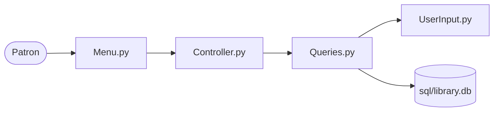
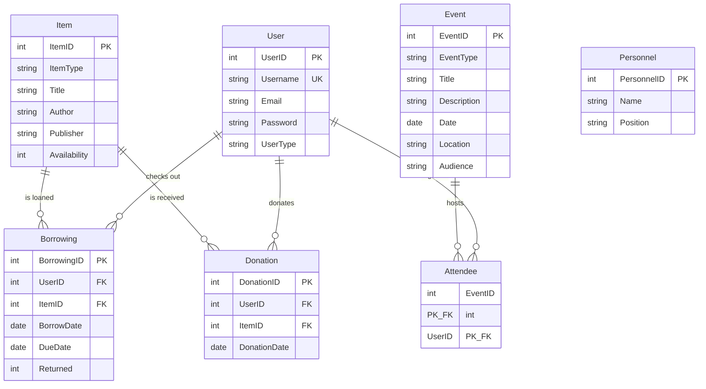

# Library Operations Console

A local library system you can actually operate: search a mixed catalog, check items out, return them, accept donations, and register patrons for events. Records live in SQLite, and the rules that keep the catalog honest live in the database, not only in the menu code.

**Python 3 · SQLite · standard library only.** Clone it and run it. Nothing to install.

## What a patron can do

| | Action | What the system does |
|---|---|---|
| 1 | **Find an item** | Browse the whole catalog, or look up a title by author |
| 2 | **Borrow an item** | Confirms the patron, checks the password, writes a loan with a due date one week out, and blocks a second loan of the same copy |
| 3 | **Return an item** | Shows what that patron currently holds and closes the loan |
| 4 | **Donate an item** | Adds the copy to the catalog and records who gave it, and when |
| 5 | **Find an event** | Filters programs by type: Book Club, Art Show, or Film Screening |
| 6 | **Register for an event** | Enrolls the patron once. A second registration is refused |
| 7 | **Volunteer** | Promotes an existing member to volunteer |
| 8 | **Ask for help** | A short orientation to how accounts, loans, and ids fit together |
| 9 | **Inspect the data** | Prints any table: items, loans, users, donations, events, attendees |

The catalog is not books-only. Seed data includes print books, online books, magazines, CDs, and records, plus a staff roster and a season of library programs.

## What is worth noticing

**The inventory rule is enforced by the database.** Checking an item out inserts a row in `Borrowing`. A trigger then marks that copy unavailable. Returning it deletes the loan, and a second trigger marks the copy available again. The application does not have to remember to flip the flag.

**A patron cannot break the relationships.** Usernames are unique. A patron and an item can appear together on at most one loan. Event attendance uses a composite primary key, so the same person cannot be enrolled in the same event twice. New accounts are refused when the username is already taken, and checkout asks for the password before it writes a loan.

**The application is split the way a larger one would be.** The menu, the command dispatch, the SQL, and the prompts are separate modules. Adding a workflow means adding one function and one entry in the dispatch table.



`MainDriver.py` starts the session. `Controller.py` owns the loop and maps each menu number to a query function. `Queries.py` owns the SQL and the loan, donation, and registration rules. `Menu.py` and `UserInput.py` own what the patron sees.

## Data model

Seven tables. `User` is the center: loans, donations, and event sign-ups all point back to a patron. `Personnel` is the staff roster kept alongside the patron data.



`Borrowing` also has `UNIQUE (UserID, ItemID)`. The two availability triggers are `update_item_attribute` (after insert) and `update_item_after_delete` (after delete).

Schema, seed data, and triggers were built in `sql/libraryDriver.ipynb`. The entity diagram and the written specification are in `documents/`.

## Run it

From the project root:

```bash
python3 MainDriver.py
```

```
=============== MENU =================
1. Find an item in the library
2. Borrow an item from the library
3. Return a borrowed item
4. Donate an item to the library
5. Find an event in the library
6. Register for an event in the library
7. Volunteer for the library
8. Ask for help from a librarian
9. Display all table data
=======================================
Choose Menu Option(1-9) or 0 to quit:
```

The database at `sql/library.db` is already loaded. To try checkout, sign in as an existing patron:

| Username | Password | Role |
|---|---|---|
| `JohnDoe` | `password123` | member |
| `Admin1` | `adminpass` | librarian |
| `VolunteerA` | `volunteerpass` | volunteer |

Choose **0** to quit. The session commits on the way out.

To rebuild the database from scratch, open `sql/libraryDriver.ipynb` and run it top to bottom. It creates `library.db`, loads the sample library, and installs the availability triggers.

## Layout

```
MainDriver.py            entry point
Controller.py            session loop and command dispatch
Menu.py                  menu text and option validation
Queries.py               SQL and lending, donation, and event rules
UserInput.py             prompts and table printing
sql/library.db           the live database
sql/libraryDriver.ipynb  schema, seed data, and triggers
documents/               specification and entity-relationship diagram
```
